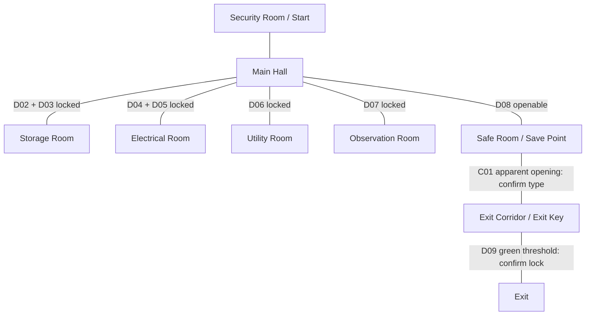

# Reference level design

Status: intended layout documented; **not implemented**. Documentation-only review, 2026-11-09. The user designates [map/game_map.png](../map/game_map.png) authoritative for intended room layout, connections and marked object locations, despite its internal “MAP EXAMPLE” caption. Mechanics not specified by the image remain decisions, not inferred requirements.

Source image: 1402×1122 pixels; SHA-256 `89089e9ab5a4ab74a3fc954a0de798ecd3251ddc776e5ef99841734fd987f790`. Coordinates below are approximate image-pixel centers from top-left, x right/y down, generally within ~10 pixels. They are reference anchors, **not Godot world coordinates**, scale, tile size or collider dimensions. Legend/sidebar icons are excluded from counts. Preserve this image; approve any design departure explicitly.

## Rooms, purposes and connections

The Main Hall is a continuous cross-shaped circulation space, including the upper horizontal passage and the central north/south spine. Small outlined recesses flanking that spine have no room labels; do not invent additional rooms or passages through them. No direct Storage–Utility or Electrical–Observation connection is depicted.

| Area | Relative layout / intended purpose | Visible connections |
| --- | --- | --- |
| Security Room / Start Area | North; player entry and orientation. Green start at (571,149); facing unspecified | Southern neck opens onto north Main Hall via D01 |
| Main Hall | Central circulation/exploration hub; note N02 | Security, both Storage entrances, both Electrical entrances, Utility, Observation, Safe Room |
| Storage Room | Northwest; battery B01 | East wall D02 and south wall D03 both lead into Main Hall |
| Electrical Room | Northeast; battery B02. No power puzzle is specified | West wall D04 and south wall D05 both lead into Main Hall |
| Utility Room | Southwest side of hall; note N01 | East wall D06 to Main Hall |
| Observation Room | Southeast side of hall; note N03 | West wall D07 to Main Hall |
| Safe Room | South of Main Hall; blue outlined rest area and marked save point S01 | North D08 to Main Hall; apparent south opening C01 to Exit Corridor |
| Exit Corridor | South of Safe Room; contains exit key K01 on right | North C01 to Safe Room; south D09 to Exit |
| Exit | Southernmost room/area; green exit sign E01 | North D09 from Exit Corridor; no further exterior geometry shown |

Diagram edges show adjacency, not initial traversability. D01 is the Security–Hall openable threshold. Both connections per upper side room must be retained; do not collapse them into one doorway.

## Door and opening register

Legend: red = “Locked Door (Requires Key)”; tan = “Door (Can Open)”; white = wall/boundary. Red does not identify which key, whether keys are consumed, or whether doors unlock together. Do not assume the exit key opens every red door.

| ID | Boundary / image anchor | Type from image |
| --- | --- | --- |
| D01 | Security southern neck ↔ north Hall, (~570,293); tan marks at both jambs | Openable threshold; two jamb marks treated as one passage, not two independent doors |
| D02 | Storage east ↔ upper Hall, (430,335) | Red locked door |
| D03 | Storage south ↔ west Hall branch, (378,427) | Red locked door |
| D04 | Electrical west ↔ upper Hall, (709,335) | Red locked door |
| D05 | Electrical south ↔ east Hall branch, (746,427) | Red locked door |
| D06 | Utility east ↔ Hall, (335,565) | Red locked door |
| D07 | Observation west ↔ Hall, (787,565) | Red locked door |
| D08 | Hall south ↔ Safe Room north, (572,621) | Tan openable door |
| C01 | Safe Room south ↔ Corridor north, (~571,803) | Apparent opening with faint tan segments; exact door type/width unclear. Preserve adjacency, confirm treatment before building it |
| D09 | Corridor south ↔ Exit north, (572,936) | Green highlighted threshold, not red/tan legend type. Flow says unlock exit; locking implementation must be clarified |

Six clear red markers and two clear tan thresholds; C01 is not counted as a confirmed third openable door. Door swing, initial open/closed state for tan doors, use from either side, interaction distance and enemy operation rules are unspecified.

## Object register and counts

| ID | Marker / intended room and position | Count / certainty |
| --- | --- | --- |
| START | Green circle inside Security Room, (571,149), below room label | 1 clear start; orientation unknown |
| B01 | Storage, left-central interior, (317,326) | 1 visible battery marker |
| B02 | Electrical, central-right interior, (829,335) | 1 visible battery marker |
| B03 | No identifiable third room marker | Summary says batteries: 3; third position unresolved. Do not place arbitrarily or assume stacks |
| N01 | Utility, lower-left interior, (225,582) | 1 story note |
| N02 | Main Hall, left of center, (499,516) | 1 story note |
| N03 | Observation, lower-central interior, (894,582) | 1 story note |
| K01 | Exit Corridor, right side, (700,873) | 1 exit key |
| S01 | Safe Room, lower-central interior, (572,754), blue circled S | 1 save-point marker; behavior conflicts with existing scope |
| E01 | Exit, lower-central interior, (572,1032) | 1 exit destination sign; not a collectible |

Visible collectible total: 2 battery markers + 3 notes + 1 key = 6. Summary target total: 3 batteries + 3 notes + 1 key = 7; one battery location is unallocated. No enemy spawn, patrol waypoint, extra key, switch, medkit or battery in Security/Safe Room is marked. Asset availability does not add objects to this register.

## Exit progression, patrol and safety

Image flow: start → explore/collect batteries and notes → find exit key → unlock exit → escape. Geometric route to key/exit: Security → Main Hall → Safe Room → Exit Corridor (K01) → Exit. Side rooms are branches; the map does not establish that every collectible is mandatory. No dependency on powering Electrical Room, collecting notes or unlocking all side doors is shown.

The key is in the corridor **before** the final Exit threshold. Do not move it behind a gate it must unlock, relocate it into Storage, or add a puzzle to force exploration. Approve D09's lock type and six side-door key requirements before progression implementation; only one key is marked.

The map note says the enemy patrols throughout the facility. It specifies no route, spawn, enemy count, dwell times, door access or LOS. Intended navigation must respect room walls, door states and confirmed connections; closed locked doors must not become navigation shortcuts. Proposed enemy exclusion from Safe Room follows docs/05 R10, but conflicts with a literal “throughout” interpretation. Resolve both Safe Room thresholds, chase cancellation/return behavior and corridor/exit access before patrol implementation. Do not infer teleportation, wall crossing, automatic door opening or new enemies.

Safe Room is visually identified and marked “Save Point”; it supports the legacy rest/safety intent. Invulnerability, exclusion, resource refills, autosave/manual save, respawn and persistence across launches are **not specified**. Keep the marker's intended location in planning; no working save system is authorized. Docs/01 excludes saves and docs/05 P04 proposes session-only state. Resolve this conflict before enabling any save behavior.

## Comparison with current implementation

- `scenes/level.tscn` contains only demo ColorRects, dark CanvasModulate, player, two enemy instances, key and fixed prompt. No named map rooms, physical walls, doors, navigation, save point, exit, batteries or notes. Map texture is not referenced by scenes.
- Current player position (758,764) and key (150,135) are prototype world positions and do not correspond to map anchors. No image-to-world transform exists.
- `scripts/player.gd` has movement/sprint/light input only; `scripts/interactables.gd::interact()` is a stub. Preserve these foundations while planning future pickup/door integration.
- `scripts/enemy.gd` and `scripts/enemy_fire.gd` use direct proximity chase/idle, not facility patrol or door-aware navigation. Both require a sibling named `player`; room organization must preserve or deliberately adapt this dependency after approval.
- Docs/01–02 support escape, batteries, notes, patrol and safety but provide no room geometry. This document/map now supplies intended spatial design. Docs/06 describes actual architecture, not this future layout.
- Existing `assets/echoes_assets/docs/ASSET-INTEGRATION.md` describes available art and proposed integration, not functioning doors/items. Its integration/commit instructions do not override this documentation-only scope or the no-commit instruction. Its colored keys/medkit do not authorize additional mechanics.
- Working tree already has a user modification declaring Godot feature 4.7 in `project.godot` and an untracked asset pack; older audit's 4.6 observation is historical. These changes were preserved; this review does not approve an engine migration or asset integration.

## Unresolved discrepancies / decision gates

| ID | Decision needed | Dependent work |
| --- | --- | --- |
| LD-Q01 | Third battery position/count discrepancy: identify it or explicitly revise summary | Final placement/count acceptance |
| LD-Q02 | Which key opens each of D02–D07? Are other keys intended? Consumption/reset rules? | Side-door behavior, branch reachability |
| LD-Q03 | C01 opening/door treatment and D09 lock/exit trigger behavior | South connections and escape integration |
| LD-Q04 | Save point versus no-save scope; precise safety and enemy behavior at both Safe Room boundaries | Save behavior and patrol exclusion |
| LD-Q05 | World scale, passage clearances, enemy spawn/count/routes and door permissions | Geometry calibration and AI; preserve player/enemy hitboxes unless separately approved |

## Level requirements and acceptance

LD IDs supplement docs/05, not implemented features. LV checks below are future manual/static procedures, not executed tests. Use docs/08 reporting format and V01–V06 regressions after implementation approval.

| Requirement | Acceptance criteria | Verification |
| --- | --- | --- |
| LD01 — topology (R01, N01) | All nine areas in relative map positions, every registered connection retained, no unmarked cross-wall route; scale documented, wall/door clearances fit existing bodies | LV01: compare editor top-down view/overlay and room/door inventory against image; walk every permitted edge and probe walls/bounds; V01–02 |
| LD02 — spawn/doors (R01, R04–05) | Start maps to Security anchor; D01–D09/C01 each accounted for; six red locks preserved; unresolved C01/D09 semantics decided before implementation; no wall tunneling or door blockage | LV02: spawn fresh; inspect threshold types/states; traverse open doors, test blocked locks from both sides under approved rules; V02–04 |
| LD03 — placements (R03–05, R09) | B01/B02, N01–N03, K01 match room/relative anchors; third battery resolved explicitly; S01 location retained without invented save behavior; one exit destination | LV03: inspect instance counts/positions against register; collect once, test prompts/ranges and fresh reset; V03, V06. Final battery count cannot pass with LD-Q01 open |
| LD04 — progression (R05, R08) | Fresh start can reach corridor key via confirmed connections and escape only after approved unlock; side-door requirements produce no self-lock; no new mandatory collectible gates | LV04: keyless exit rejection, key pickup/unlock/win, restart; check each side-door key route for circular dependencies; V04 |
| LD05 — patrol/safety (R06–07, R10) | Approved route reaches permitted facility areas, respects walls and door state; approved Safe Room behavior holds at north and south boundaries | LV05: patrol/chase/loss and closed/open door tests, approach both safety thresholds, test return/reset; V05–06 |
| LD06 — preserve baseline (R01–02, N02) | Movement, sprint, camera, lights, scene resources/signals retained; no incidental framework, save system or asset migration | LV06: scoped diff, V01–02 plus affected V03–06; record manual results separately from engine smoke |

Implementation tasks and ordering are in docs/07. This review performed visual inspection, source/document comparison and documentation checks only; no runtime tests or level implementation.
